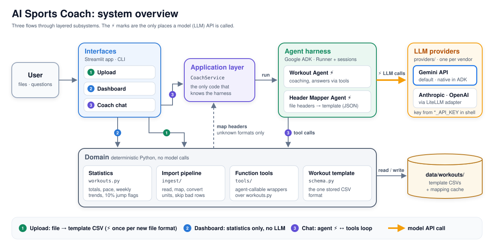

<p align="center">
  
</p>

<h1 align="center">AI Sports Coach</h1>

A multi-agent AI running coach built on a provider-agnostic agent harness.
Cycle 1 uses **Google ADK** as the harness. **Gemini** runs natively, and
**Anthropic** and **OpenAI** run through ADK's LiteLLM adapter.

## Setup

```bash
python3 -m venv .venv
source .venv/bin/activate
pip install -r requirements.txt
```

## Configuration

Settings that aren't secret live in [`config/settings.toml`](config/settings.toml):
the vendors, their models, generation parameters and the data directory.
Secrets and the provider choice come from your shell:

```bash
export PROVIDER=gemini            # gemini | anthropic | openai (overrides default_provider)
export GEMINI_API_KEY=...
export ANTHROPIC_API_KEY=...      # only needed when PROVIDER=anthropic
export OPENAI_API_KEY=...         # only needed when PROVIDER=openai
export MODEL=gemini-2.5-pro       # optional: override the provider's model
export SPORT_COACH_CONFIG=...     # optional: use another TOML file
```

The TOML file only stores the *name* of each key's environment variable
(`api_key_env`), never the key itself.

## Run

```bash
streamlit run app.py                  # web app: upload, dashboard, coach chat
python -m sport_coach.cli --trace     # console chat (prints tool calls)
```

The web app has:
- **Upload**: any workout CSV/TSV or Excel/ODS export in the sidebar. If it doesn't match our template,
  it is mapped automatically and you get a summary of the mapping plus a download of the processed CSV.
- **Dashboard**: headline numbers and charts (weekly distance with >10% jumps flagged, pace, long run,
  frequency, training time, calories, heart rate, elevation, cadence). Each panel needs certain
  template fields; panels for data your file doesn't have are shown as placeholders.
- **Coach**: chat with the agent about the selected file, with live tool-call status.

The dashboard works without an API key; only the chat needs one.

### Workout template

The app stores every file in one CSV template ([sport_coach/schema.py](sport_coach/schema.py)):

`date, activity, distance_km, duration_min, pace_min_per_km, calories, avg_hr, max_hr, elevation_gain_m, cadence_spm, notes`

Only `date` plus one measurement is required; any other column can be empty.

### Importing workouts

Upload any table with a header row: a watch-app export, a spreadsheet or your own log,
in any language ([sport_coach/ingest/](sport_coach/ingest/)):

1. **Read**: CSV/TSV/TXT (any delimiter or encoding) or Excel/ODS. Title rows above the header are ignored.
2. **Already our template?** Then it's imported as is.
3. **Otherwise, map headers to the template**:
   - with an API key, the **Header Mapper agent** (LLM, structured output) gets the headers plus
     5 sample rows and returns which column fills each template field and its unit. Answers are cached
     per header set, so a given export format costs one model call.
   - **built-in rules** (synonyms, close spelling) fill any gaps, and do all the mapping without a key.
   - every match is checked against the column's values, so a wrong guess is dropped.
4. **Copy the data into the template in Python**: unit conversion (km/mi/m, min/s/h, h:mm:ss, pace,
   ft), date formats, Excel cells. Pace, duration or distance are calculated when two of them are known.
   The LLM never touches the values.
5. **Save and report**: "Your file didn't match our template, so we mapped it automatically", listing
   what was mapped, what was calculated, what isn't in the file and which rows were skipped (e.g. a
   `TOTAL` row), with a **Download processed CSV** button.

Header names and 5 sample rows are sent to the configured LLM provider when an API key is set.
Imports are saved in `data/workouts/`; git ignores them because they're personal data, and
only `sample_runs.csv` is tracked.

## Architecture



- **Interfaces** (Streamlit, CLI) talk only to the **application layer** (`CoachService`), the one place that knows the agent harness.
- The **agent harness** (Google ADK) runs two agents, the **Workout Agent** (chat) and the **Header Mapper** (upload). These are the only ⚡ LLM calls: **Gemini API** by default, Anthropic or OpenAI via LiteLLM.
- The **domain** (statistics, import pipeline, tools, template) is deterministic Python, so the LLM decides and Python computes.

**Details → [docs/ARCHITECTURE.md](docs/ARCHITECTURE.md)**

1. [What happens when a file is uploaded](docs/ARCHITECTURE.md#1-uploading-a-file)
2. [How the dashboard graphs are computed](docs/ARCHITECTURE.md#2-computing-the-dashboard-graphs)
3. [Chatting with the coach](docs/ARCHITECTURE.md#3-chatting-with-the-coach)
4. [Where the LLM (Gemini API) is called](docs/ARCHITECTURE.md#where-the-llm-is-called)

## Layout

```
ai-sport-coach/
├── app.py                      # Streamlit entry point
├── requirements.txt            # dependencies
├── pytest.ini                  # test settings
├── config/
│   └── settings.toml           # providers, models, params (no secrets)
├── assets/                     # logo.png, icon.png, favicon.png/.ico
├── docs/
│   ├── overview.svg            # system overview image
│   └── ARCHITECTURE.md         # detailed flows and LLM call points
├── data/
│   └── workouts/               # template CSVs (only sample_runs.csv is tracked)
├── sport_coach/
│   ├── config.py               # TOML + env vars → Settings
│   ├── schema.py               # the workout template (single source of truth)
│   ├── service.py              # CoachService (async) + SyncCoachService (Streamlit)
│   ├── workouts.py             # template CSV parsing, storage, statistics
│   ├── cli.py                  # console interface
│   ├── agents/
│   │   ├── workout_agent.py    # coach: answers via tools          ⚡ LLM
│   │   └── header_mapper.py    # maps file headers → template      ⚡ LLM
│   ├── providers/              # one adapter per LLM vendor
│   │   ├── __init__.py         # registry + build_model() / build_generation_config()
│   │   ├── base.py             # Provider interface and defaults
│   │   ├── gemini.py           # native in ADK (google-genai)
│   │   ├── anthropic.py        # via LiteLLM; sends no temperature
│   │   ├── openai.py           # via LiteLLM; optional base_url
│   │   └── _litellm.py         # shared LiteLLM wrapping
│   ├── tools/
│   │   └── workout_tools.py    # function tools over workouts.py
│   ├── ingest/                 # import any file into the template
│   │   ├── reader.py           # file → table, header-row and sheet detection
│   │   ├── parsers.py          # numbers, durations, dates; column-fits-field checks
│   │   ├── rules.py            # built-in header matching (AI fallback / gap-filler)
│   │   ├── mapping.py          # template / AI / rules → column + unit mapping
│   │   ├── convert.py          # copy data into the template, convert units
│   │   └── pipeline.py         # import_file + result shown to the user
│   └── ui/
│       ├── dashboard.py        # tiles + panels driven by available data
│       ├── uploads.py          # upload handling + "mapped automatically" notice
│       └── chat.py             # coach chat with live tool-call status
└── tests/
    ├── fixtures/               # runs_legacy.xls
    └── test_*.py               # agents, config, ingest, providers, service, tools, workouts
```

### Adding a provider

1. Create `sport_coach/providers/<name>.py` with a `Provider` subclass: set `name`, implement
   `build_model()`, and override defaults where the vendor differs (e.g. `supports_temperature = False`).
   For a vendor LiteLLM supports, subclass `LiteLlmProvider` and set `prefix`; that's usually all.
2. Add it to `PROVIDERS` in `sport_coach/providers/__init__.py`.
3. Add a `[llm.providers.<name>]` section to `settings.toml`.

You don't need to change any agents, tools or UI. A model that differs from its vendor's default
(e.g. an OpenAI reasoning model that rejects temperature) is handled in `settings.toml` with
`supports_temperature = true | false`.

## Tests

```bash
pytest
```
