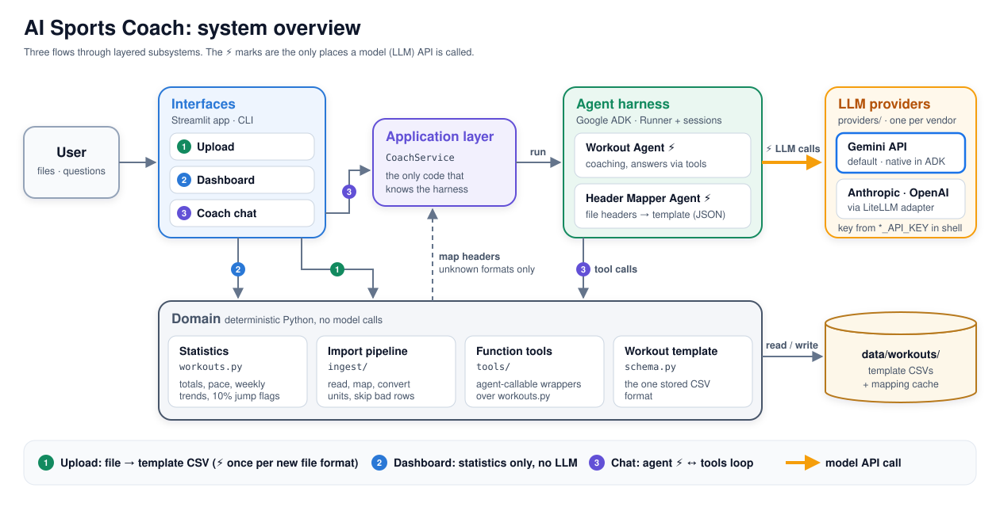
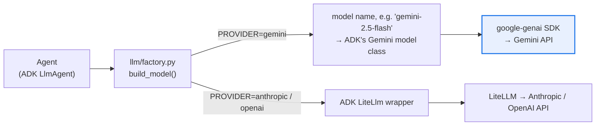
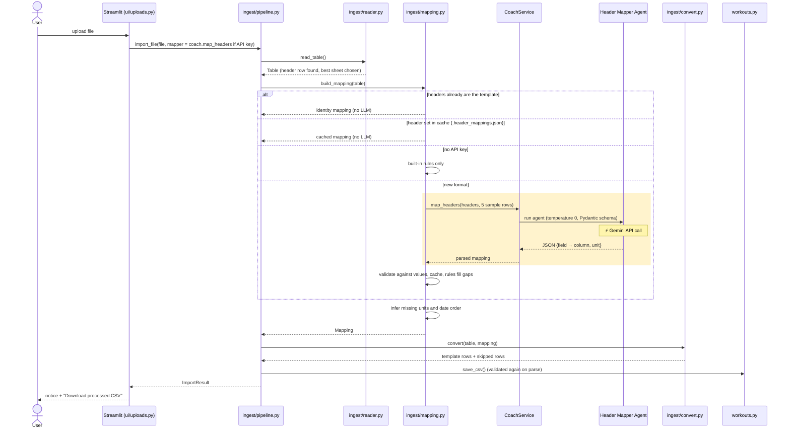
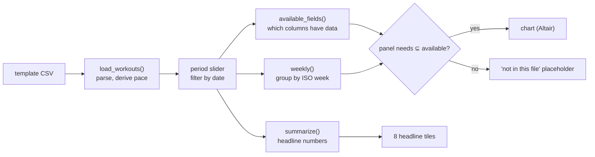
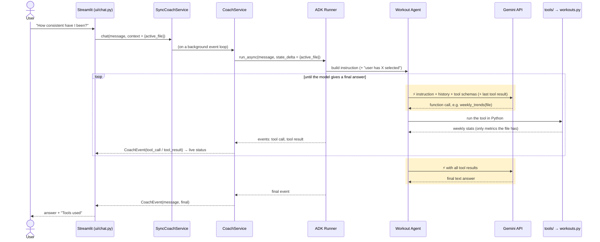

# Architecture

This page explains the three flows through the system in detail, and exactly where
a model (LLM) API is called.

- [Subsystems](#subsystems)
- [Where the LLM is called](#where-the-llm-is-called)
- [1. Uploading a file](#1-uploading-a-file)
- [2. Computing the dashboard graphs](#2-computing-the-dashboard-graphs)
- [3. Chatting with the coach](#3-chatting-with-the-coach)

---

## Subsystems

| Subsystem | Code | Responsibility | May depend on |
|---|---|---|---|
| **Interfaces** | [app.py](../app.py), [ui/](../sport_coach/ui/), [cli.py](../sport_coach/cli.py) | Upload, dashboard, coach chat | Application layer, domain. **Never ADK.** |
| **Application layer** | [service.py](../sport_coach/service.py) | Entry point for all agent work: `chat()` and `map_headers()`. Converts ADK events into our own `CoachEvent`s | Harness |
| **Agent harness** | Google ADK + [agents/](../sport_coach/agents/) | Runs agents: the loop of model calls and tool calls, plus sessions | LLM layer, tools |
| **LLM layer** | [llm/factory.py](../sport_coach/llm/factory.py), [config.py](../sport_coach/config.py) | Turns `PROVIDER` + `settings.toml` into a model ADK can call | Vendor APIs |
| **Domain** | [workouts.py](../sport_coach/workouts.py), [ingest/](../sport_coach/ingest/), [tools/](../sport_coach/tools/), [schema.py](../sport_coach/schema.py) | Template, import, statistics, tools. Plain Python, no model calls | Nothing above it |
| **Data** | `data/workouts/` | Template CSVs and the header-mapping cache | — |

The **harness** (ADK) and the **LLM** are separate things. ADK decides *when* to
call a model and runs the tools the model asks for; the model is reached through
the LLM layer. Swapping Gemini for Claude changes the LLM layer only.

---

## Where the LLM is called

There are exactly **two call sites**, both agents run by ADK through `CoachService`:

| ⚡ Call site | Triggered by | What is sent to the model | Calls | Temperature |
|---|---|---|---|---|
| **Workout Agent** ([workout_agent.py](../sport_coach/agents/workout_agent.py)) | Every chat message | Instruction (+ selected file), conversation history, tool schemas, tool results | 1 + one per tool round (typically 2–3 per message) | 0.3 (`settings.toml`)¹ |
| **Header Mapper Agent** ([header_mapper.py](../sport_coach/agents/header_mapper.py)) | Upload of a file in a **new** format | Template field descriptions, the file's headers, **5 sample rows** | At most 1 per new header set (then cached) | 0¹ |

¹ Not sent to providers with `supports_temperature = false` in `settings.toml` (Anthropic: current
Claude models reject sampling parameters), so they use the model's default.

**Never** calling a model: the dashboard, statistics, unit conversion, CSV parsing,
uploads already in our template, and uploads whose header set is in the cache.

### How a call reaches the Gemini API

- **Gemini (default):** the factory returns the model name; ADK resolves it to its
  built-in Gemini model, which calls the Gemini API through Google's `google-genai`
  SDK. `GEMINI_API_KEY` is passed to that SDK as `GOOGLE_API_KEY`.
- **Anthropic / OpenAI:** the factory wraps the model in ADK's `LiteLlm`, and LiteLLM
  translates ADK's requests into each vendor's API.
- **Structured output** (Header Mapper): ADK sends the Pydantic schema as Gemini's
  response schema, or as a LiteLLM `response_format` for other vendors. Either way the
  reply is validated with Pydantic before use.

---

## 1. Uploading a file

**Goal:** turn any CSV/Excel export into our [workout template](../sport_coach/schema.py)
CSV. The model only *names columns and units*; Python converts every value.

### Step by step

| Step | Module | What happens |
|---|---|---|
| Read | [reader.py](../sport_coach/ingest/reader.py) | CSV/TSV/TXT with any delimiter or encoding, or Excel/ODS (via `calamine`). Each of the first 15 rows is scored to find the header, skipping title rows. For workbooks, the sheet that looks most like a workout log wins |
| Template check | [mapping.py](../sport_coach/ingest/mapping.py) | If every header is already a template column, the file is used as-is and the user isn't told it was mapped |
| ⚡ AI mapping | [header_mapper.py](../sport_coach/agents/header_mapper.py) | Only for a new header set with an API key. Returns `{field, column, unit}` matches and the date order |
| Validate | [mapping.py](../sport_coach/ingest/mapping.py) | Each AI match must name a real, unused column whose values mostly (≥ 50%) fit the field's type, and units must be from the allowed list. Rejected matches are noted |
| Fill gaps | [rules.py](../sport_coach/ingest/rules.py) | Synonyms, close spelling and value checks (≥ 70% fit) map anything the AI left out, or everything when there's no key or the call failed |
| Units | [mapping.py](../sport_coach/ingest/mapping.py) | From the AI, otherwise from the header (`(mi)`, `seconds`), the values (`5 km`) or typical sizes (a median over 200 suggests metres) |
| Convert | [convert.py](../sport_coach/ingest/convert.py) | Per row: parse the date (skip the row if there isn't one), convert each measurement to template units, and calculate pace, duration or distance when two of the three are known. Unreadable cells are left empty and counted |
| Save | [workouts.py](../sport_coach/workouts.py) | Written as template CSV (all columns, fixed order) to `data/workouts/<name>.csv` |
| Report | [uploads.py](../sport_coach/ui/uploads.py) | "Your file didn't match our template, so we mapped it automatically": mapped columns, conversions, calculated fields, missing data, skipped rows, and a download of the processed CSV |

**Minimum to import:** a date plus at least one measurement. Otherwise the upload
fails and says why ("no date column was found").

**Privacy:** with an API key, the headers and 5 sample rows go to the configured
provider. Nothing else from the file is sent.

---

## 2. Computing the dashboard graphs

**No model is involved.** Every number comes from [workouts.py](../sport_coach/workouts.py),
the same code the coach's tools use, so the charts and the coach always agree.

### Headline tiles ([`summarize()`](../sport_coach/workouts.py))

| Tile | Calculation | Needs |
|---|---|---|
| Workouts | number of workouts in the period | — |
| Per week | workouts ÷ max(days spanned ÷ 7, 1) | — |
| Distance | Σ distance | distance |
| Time | Σ duration | duration |
| Avg pace | Σ duration ÷ Σ distance over workouts that have both (distance-weighted); otherwise the mean of stored paces | pace |
| Longest | max distance (and its date) | distance |
| Calories | Σ calories | calories |
| Avg HR | mean of average heart rate | avg_hr |

Pace is stored if the file had it, otherwise calculated as `duration ÷ distance` on load.

### Charts ([`weekly()`](../sport_coach/workouts.py) and per-workout rows)

Weeks are ISO weeks (Monday start); a week's values are `null` when it has no data
for that field.

| Panel | Calculation | Needs |
|---|---|---|
| Weekly distance | Σ distance per week; % change vs previous week; weeks up **more than 10%** are amber with a "+x%" label and a warning banner | distance |
| Pace per workout | pace of each workout, axis reversed (faster is higher) | pace |
| Long run per week | max distance per week | distance |
| Workouts per week | count per week | — |
| Weekly training time | Σ duration per week | duration |
| Weekly calories | Σ calories per week | calories |
| Average heart rate | avg HR of each workout | avg_hr |
| Weekly elevation gain | Σ elevation gain per week | elevation |
| Cadence | cadence of each workout | cadence |

Each panel declares the fields it needs ([`PANELS`](../sport_coach/ui/dashboard.py)).
Panels with data render as charts in two columns; the rest appear under "Not in this
file". The period slider filters the workouts before any of this runs, so every number
follows the selected range.

---

## 3. Chatting with the coach

**Goal:** natural-language coaching where the model decides *what* to look at, and
tools compute *every number*.

### What the model gets

- **Instruction** ([workout_agent.py](../sport_coach/agents/workout_agent.py)): use tools
  for every number; discuss only metrics in `available_metrics`; flag weekly volume jumps
  over 10%; stay general and suggest a professional for pain or injury.
- **Context:** the file selected in the sidebar is written to session state, and the
  instruction function adds "the user has *X* selected", so the user doesn't have to name it.
- **History:** the session's earlier messages and tool results (ADK sessions, in memory).
- **Tools:**

| Tool | Returns |
|---|---|
| `list_workout_files()` | files in `data/workouts/` |
| `summarize_workouts(file)` | totals, averages, pace, fastest and longest, HR, elevation, cadence, plus `available_metrics` / `not_available` |
| `weekly_trends(file)` | per-week distance, time, pace, long run, calories, HR, elevation, % change, jump flag |

Tool errors (missing file, bad name) come back as `{"status": "error", ...}` so the
model can explain them instead of the chat crashing.

### What the UI gets

`CoachService` translates ADK events into harness-neutral
[`CoachEvent`](../sport_coach/service.py)s: `tool_call`, `tool_result` and `message`
(with `final`). The chat shows a live status ("Running weekly_trends…"), then the answer
with the tools used. Streamlit uses `SyncCoachService`, which keeps one background
event loop because the Gemini and LiteLLM clients can't be shared across event loops.

**Notes:** chat needs an API key. Sessions are in memory, so a restart starts a new
conversation (long-term memory and persistence come in Phase 3).
